# Modelo de base de datos — LittleStyle

Documento del modelo de datos del backend LittleStyle. Se obtuvo de las entidades JPA
(`src/main/java/**/model/*.java`), que son la fuente de verdad del esquema, y de los scripts de
migración en `docs/us-07`, `docs/us-11` y `docs/us-12`.

| Aspecto | Valor |
|---|---|
| Motor | MySQL 8 (AWS RDS en producción, MySQL en contenedor en local); H2 en modo MySQL para el perfil `local` |
| Base de datos | `littlestyle` |
| Gestión del esquema | Hibernate/JPA. `ddl-auto=validate` en `prod`, `update` en `dev`/`local` y en el perfil puntual `perfiles-migracion`; cambios de producción con scripts SQL versionados en `docs/us-*/migracion-*.sql` |
| Claves primarias | `BIGINT AUTO_INCREMENT` (`GenerationType.IDENTITY`), salvo `pedido_idempotencia` y `perfil_datos_cifrado_version` (clave natural `VARCHAR`) |
| Enumeraciones | Guardadas como texto (`EnumType.STRING`) |
| Dinero | `DECIMAL(12,2)` en COP; en `transacciones_pago` se usa `monto_centavos BIGINT` (formato de Wompi) |

## 1. Diagrama entidad-relación

Versión vectorial para ampliar sin perder calidad: [diagrama-er.svg](diagrama-er.svg). Fuente Mermaid:

```mermaid
erDiagram
    usuarios ||--o| carritos : "tiene"
    usuarios ||--o| direcciones_cliente : "registra"
    usuarios ||--o{ perfiles_infantiles : "administra"
    usuarios ||--o{ prendas : "publica (vendedor)"
    usuarios ||--o{ pedidos : "realiza (cliente)"
    usuarios ||--o{ despachos : "atiende (vendedor)"
    usuarios |o--o{ transacciones_pago : "paga"

    carritos ||--o{ carrito_items : "contiene"
    prendas ||..o{ carrito_items : "prenda_id (ref. lógica)"

    prendas ||--o{ prenda_tallas : "se ofrece en"
    prendas ||--o{ prenda_imagenes : "muestra"
    prendas ||--o{ prenda_colores : "tiene"
    prendas ||--o{ prenda_composicion : "se compone de"
    prendas ||--o{ alertas_reabastecimiento : "genera"

    perfiles_infantiles ||--o{ mediciones_crecimiento : "registra"
    perfiles_infantiles ||--o{ perfil_colores_preferidos : "prefiere"
    perfiles_infantiles ||--o{ perfil_estampados_preferidos : "prefiere"
    perfiles_infantiles ||..o{ pedidos : "perfil_infantil_id (ref. lógica)"

    pedidos ||--o{ pedido_items : "incluye"
    pedidos ||--o{ despachos : "se divide en"
    pedidos ||--o{ pedido_estados : "historial"
    pedidos |o--o{ transacciones_pago : "se cobra con"
    pedidos ||..o| pedido_idempotencia : "pedido_id (ref. lógica)"
    despachos |o--o{ pedido_items : "agrupa"
    despachos |o--o{ pedido_estados : "historial"
    prendas ||..o{ pedido_items : "prenda_id (ref. lógica)"

    transacciones_pago ||--o{ transacciones_pago_agotadas : "reporta"

    usuarios {
        BIGINT id PK
        VARCHAR nombre
        VARCHAR apellido
        VARCHAR email UK
        VARCHAR password "hash BCrypt"
        VARCHAR telefono
        VARCHAR nombre_tienda
        VARCHAR rol "CLIENTE|VENDEDOR|ADMINISTRADOR"
        VARCHAR estado "ACTIVO|SUSPENDIDO|ELIMINADO"
        DATETIME fecha_registro
        VARCHAR version_terminos
        DATETIME fecha_aceptacion_terminos
    }
    carritos {
        BIGINT id PK
        BIGINT cliente_id FK,UK
    }
    carrito_items {
        BIGINT id PK
        BIGINT carrito_id FK
        BIGINT prenda_id
        VARCHAR talla
        INT cantidad
        VARCHAR talla_sugerida
    }
    prendas {
        BIGINT id PK
        BIGINT vendedor_id FK
        VARCHAR nombre
        VARCHAR categoria
        VARCHAR genero
        VARCHAR descripcion
        VARCHAR instrucciones_cuidado
        VARCHAR marca
        DECIMAL precio
        VARCHAR estado "ACTIVA|INACTIVA"
        VARCHAR estampado
        BOOLEAN tintes_sinteticos
        BOOLEAN broches_metalicos
        BOOLEAN contiene_niquel
        BOOLEAN tratamiento_formaldehido
        DATETIME fecha_creacion
        DATETIME fecha_actualizacion
    }
    prenda_tallas {
        BIGINT id PK
        BIGINT prenda_id FK
        VARCHAR talla
        DECIMAL estatura_min_cm
        DECIMAL estatura_max_cm
        DECIMAL peso_min_kg
        DECIMAL peso_max_kg
        INT edad_min_meses
        INT edad_max_meses
        INT stock_minimo
        INT stock
    }
    prenda_imagenes {
        BIGINT id PK
        BIGINT prenda_id FK
        VARCHAR url
        VARCHAR clave_almacenamiento
        INT orden
        DATETIME fecha_carga
    }
    prenda_colores {
        BIGINT prenda_id FK
        VARCHAR color
    }
    prenda_composicion {
        BIGINT prenda_id FK
        VARCHAR material
        INT porcentaje
    }
    alertas_reabastecimiento {
        BIGINT id PK
        BIGINT prenda_id FK
        VARCHAR talla
        VARCHAR nivel "DISPONIBLE|STOCK_BAJO|AGOTADO"
        INT stock_al_emitir
        INT stock_minimo_al_emitir
        DATETIME fecha_emision
        DATETIME fecha_resolucion
    }
    perfiles_infantiles {
        BIGINT id PK
        BIGINT cliente_id FK
        VARCHAR nombre "cifrado"
        VARCHAR fecha_nacimiento "cifrado"
        VARCHAR contextura "cifrado"
        VARCHAR holgura "cifrado"
        VARCHAR alergias_cifradas "cifrado"
        VARCHAR otra_alergia_cifrada "cifrado"
        VARCHAR sin_alergias "cifrado"
        VARCHAR otro_color_cifrado "cifrado"
        VARCHAR otro_estampado_cifrado "cifrado"
        DATETIME fecha_creacion
        DATETIME fecha_actualizacion
    }
    mediciones_crecimiento {
        BIGINT id PK
        BIGINT perfil_id FK
        VARCHAR fecha_medicion "cifrado"
        VARCHAR estatura_cifrada "cifrado"
        VARCHAR peso_cifrado "cifrado"
    }
    perfil_colores_preferidos {
        BIGINT perfil_id FK
        VARCHAR color "cifrado"
    }
    perfil_estampados_preferidos {
        BIGINT perfil_id FK
        VARCHAR estampado "cifrado"
    }
    direcciones_cliente {
        BIGINT id PK
        BIGINT cliente_id FK,UK
        VARCHAR destinatario "cifrado"
        VARCHAR direccion "cifrado"
        VARCHAR complemento "cifrado"
        VARCHAR codigo_postal "cifrado"
        VARCHAR departamento "cifrado"
        VARCHAR ciudad "cifrado"
        VARCHAR telefono "cifrado"
    }
    pedidos {
        BIGINT id PK
        BIGINT cliente_id FK
        BIGINT perfil_infantil_id
        VARCHAR estado
        VARCHAR destinatario "cifrado"
        VARCHAR direccion "cifrado"
        VARCHAR complemento "cifrado"
        VARCHAR codigo_postal "cifrado"
        VARCHAR departamento "cifrado"
        VARCHAR ciudad "cifrado"
        VARCHAR telefono "cifrado"
        VARCHAR numero_guia
        DECIMAL subtotal
        DECIMAL costo_envio
        DECIMAL total
        DATETIME fecha_creacion
        DATETIME fecha_actualizacion
    }
    pedido_items {
        BIGINT id PK
        BIGINT pedido_id FK
        BIGINT despacho_id FK
        BIGINT prenda_id
        VARCHAR nombre
        VARCHAR talla
        INT cantidad
        VARCHAR talla_sugerida
        DECIMAL precio_unitario
        DECIMAL subtotal
    }
    despachos {
        BIGINT id PK
        BIGINT pedido_id FK
        BIGINT vendedor_id FK
        VARCHAR estado
        VARCHAR numero_guia
        DATETIME fecha_actualizacion
    }
    pedido_estados {
        BIGINT id PK
        BIGINT pedido_id FK
        BIGINT despacho_id FK
        VARCHAR estado_anterior
        VARCHAR estado_nuevo
        DATETIME fecha_cambio
        VARCHAR numero_guia
    }
    pedido_idempotencia {
        VARCHAR clave PK
        BIGINT cliente_id
        BIGINT pedido_id
        DATETIME expira
    }
    transacciones_pago {
        BIGINT id PK
        BIGINT cliente_id FK
        BIGINT pedido_id FK
        TEXT snapshot_checkout "cifrado"
        VARCHAR clave_idempotencia
        VARCHAR referencia UK
        VARCHAR wompi_transaccion_id
        BIGINT monto_centavos
        VARCHAR moneda
        VARCHAR estado
        VARCHAR metodo_pago
        VARCHAR motivo_reembolso
        DATETIME fecha_creacion
        DATETIME fecha_actualizacion
    }
    transacciones_pago_agotadas {
        BIGINT transaccion_id FK
        BIGINT prenda_id
        VARCHAR nombre
        VARCHAR talla
        INT cantidad_solicitada
        INT stock_disponible
    }
    perfil_datos_cifrado_version {
        VARCHAR version PK
        DATETIME completada_en
    }
```

Leyenda: línea continua = llave foránea física; línea punteada = referencia lógica por id, sin
`FOREIGN KEY` en la base de datos (ver sección 4).

## 2. Tablas por módulo

### 2.1 Autenticación (`modules/auth`)

| Tabla | Propósito | Claves y restricciones |
|---|---|---|
| `usuarios` | Clientes, vendedores y administradores | PK `id`; `email` UNIQUE; NOT NULL en nombre, apellido, email, password, rol, estado, fecha_registro. Borrado lógico con `estado = ELIMINADO` |

### 2.2 Perfiles infantiles (`modules/perfilesinfantiles`)

| Tabla | Propósito | Claves y restricciones |
|---|---|---|
| `perfiles_infantiles` | Perfil de cada niño (datos de talla, alergias, gustos) | PK `id`; FK `cliente_id → usuarios.id` NOT NULL. Máximo `app.perfiles.max` perfiles por cliente (validado en servicio) |
| `mediciones_crecimiento` | Historial de estatura y peso | PK `id`; FK `perfil_id → perfiles_infantiles.id` NOT NULL; borrado en cascada desde el perfil (JPA `orphanRemoval`) |
| `perfil_colores_preferidos` | Colores preferidos | FK `perfil_id`; UNIQUE (`perfil_id`, `color`) |
| `perfil_estampados_preferidos` | Estampados preferidos | FK `perfil_id`; UNIQUE (`perfil_id`, `estampado`) |
| `perfil_datos_cifrado_version` | Control de la migración de cifrado de datos ya existentes | PK `version` |

### 2.3 Catálogo e inventario (`modules/catalogocompras/catalogo`, `inventario`)

| Tabla | Propósito | Claves y restricciones |
|---|---|---|
| `prendas` | Prenda publicada por un vendedor | PK `id`; FK `vendedor_id → usuarios.id` NOT NULL; índices por vendedor, estado, género, categoría, precio y fecha de actualización |
| `prenda_tallas` | Tallas de cada prenda con rangos de estatura/peso/edad y stock | PK `id`; FK `prenda_id` NOT NULL; UNIQUE (`prenda_id`, `talla`) |
| `prenda_imagenes` | Imágenes (S3 o disco local) | PK `id`; FK `prenda_id` NOT NULL |
| `prenda_colores` | Colores de la prenda | FK `prenda_id` |
| `prenda_composicion` | Materiales y porcentaje | FK `prenda_id`; `material` y `porcentaje` NOT NULL |
| `alertas_reabastecimiento` | Alertas de stock bajo/agotado; abierta mientras `fecha_resolucion` es NULL | PK `id`; FK `prenda_id` NOT NULL; índice (`prenda_id`, `fecha_resolucion`) |

### 2.4 Carrito, checkout y despachos (`carrito`, `checkout`)

| Tabla | Propósito | Claves y restricciones |
|---|---|---|
| `carritos` | Un carrito por cliente | PK `id`; FK `cliente_id → usuarios.id` NOT NULL UNIQUE (relación 1:1) |
| `carrito_items` | Prendas en el carrito | PK `id`; FK `carrito_id` NOT NULL; UNIQUE (`carrito_id`, `prenda_id`, `talla`) |
| `direcciones_cliente` | Última dirección de envío del cliente | PK `id`; FK `cliente_id` NOT NULL UNIQUE (1:1) |
| `pedidos` | Pedido del cliente con dirección de envío y totales | PK `id`; FK `cliente_id` NOT NULL |
| `pedido_items` | Líneas del pedido | PK `id`; FK `pedido_id` NOT NULL; FK `despacho_id` (nullable) |
| `despachos` | Parte del pedido que atiende cada vendedor | PK `id`; FK `pedido_id`, FK `vendedor_id` NOT NULL; UNIQUE (`pedido_id`, `vendedor_id`) |
| `pedido_estados` | Historial (auditoría) de cambios de estado | PK `id`; FK `pedido_id` NOT NULL; FK `despacho_id` nullable; índice por `pedido_id` |
| `pedido_idempotencia` | Evita pedidos duplicados por reintentos | PK `clave`; registro con fecha de expiración |

### 2.5 Pagos (`pago`)

| Tabla | Propósito | Claves y restricciones |
|---|---|---|
| `transacciones_pago` | Transacciones con la pasarela Wompi | PK `id`; FK `cliente_id`, FK `pedido_id` (nullable: la transacción existe antes que el pedido); `referencia` UNIQUE; UNIQUE (`cliente_id`, `clave_idempotencia`); índices por pedido, cliente y `wompi_transaccion_id` |
| `transacciones_pago_agotadas` | Prendas sin stock al confirmar el pago (motivo de reembolso) | FK `transaccion_id` |

## 3. Restricciones de integridad

- **Entidad:** todas las tablas tienen PK; las tablas de colección (`prenda_colores`, `prenda_composicion`, etc.) se identifican por su FK más el valor.
- **Referencial:** 23 llaves foráneas físicas (todas las relaciones `@ManyToOne` / `@OneToOne` / `@ElementCollection`).
- **Unicidad:** `usuarios.email`, `carritos.cliente_id`, `direcciones_cliente.cliente_id`, `transacciones_pago.referencia`, (`prenda_id`,`talla`), (`carrito_id`,`prenda_id`,`talla`), (`pedido_id`,`vendedor_id`), (`cliente_id`,`clave_idempotencia`), (`perfil_id`,`color`), (`perfil_id`,`estampado`).
- **Dominio:** `NOT NULL`, longitudes máximas, `DECIMAL` con precisión fija y enumeraciones cerradas en la aplicación. Las validaciones de rango (stock ≥ 0, porcentajes que suman 100, transiciones de estado válidas) se hacen en la capa de servicio y en métodos de dominio (`Pedido.transicionarA`, `Despacho.transicionarA`).
- **Concurrencia:** bloqueo pesimista (`SELECT … FOR UPDATE`) al descontar stock y editar prendas o perfiles; claves de idempotencia en pedidos y pagos.

## 4. Decisiones de diseño y redundancia controlada

- **Referencias lógicas sin FK física:** `carrito_items.prenda_id`, `pedido_items.prenda_id`, `pedidos.perfil_infantil_id`, `pedido_idempotencia.*` y `transacciones_pago_agotadas.prenda_id`. Se guarda solo el id para que borrar o desactivar una prenda o perfil no rompa pedidos históricos; la existencia se valida en el servicio.
- **Copias intencionales (snapshot):** `pedidos` guarda la dirección de envío y `pedido_items` guarda nombre y precio unitario de la prenda en el momento de la compra. Así el pedido no cambia si el cliente edita su dirección o el vendedor cambia el precio.
- **Campos derivados:** `pedido_items.subtotal`, `pedidos.subtotal` y `pedidos.total` se calculan al crear el pedido y no se modifican después; se guardan por trazabilidad contable.
- **Estado del pedido derivado de despachos:** `pedidos.estado` se recalcula a partir de los `despachos` de cada vendedor (por ejemplo, `PARCIALMENTE_ENVIADO`).
- **Datos sensibles de menores y direcciones:** se cifran en la aplicación con AES/GCM (`CifradoPerfil`, converters en `perfilesinfantiles/repository/converter`) antes de llegar a la base de datos. Por eso esas columnas son `VARCHAR`/`TEXT` aunque el dato original sea fecha o número.

## 5. Seguridad del acceso y operación

- Credenciales de la base de datos por variables de entorno (`DB_HOST`, `DB_USER`, `DB_PASSWORD`); no se versionan.
- Conexión con TLS obligatorio (`sslMode=REQUIRED`) en `dev` y `prod`.
- En AWS, el security group de RDS solo acepta el puerto 3306 desde `sg-littlestyle-web` (ver `docs/us-13/despliegue-aws.md`).
- La base de datos no se expone a clientes: solo el backend accede, y la API está protegida con JWT y roles (`SecurityConfig`).
- Contraseñas de usuarios con hash BCrypt; datos personales de menores y direcciones cifrados con AES/GCM (clave `PERFIL_ENC_KEY`).
- En producción `ddl-auto=validate`: la aplicación no altera el esquema; los cambios se aplican con los scripts de migración.

## 6. Respaldo y recuperación

Pendiente de formalizar. RDS MySQL tiene backups automáticos diarios y recuperación a un punto en el
tiempo cuando el periodo de retención es mayor que 0, pero la configuración de retención de la
instancia del proyecto no está documentada en el repositorio. Las imágenes de prendas viven en S3
(producción) o en el volumen Docker `uploads` (local), que tampoco tiene respaldo definido.
