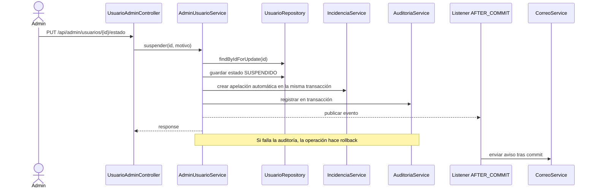
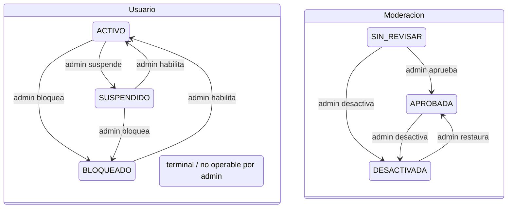
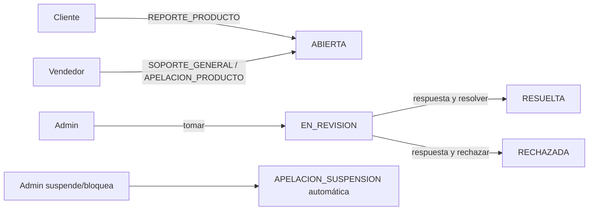
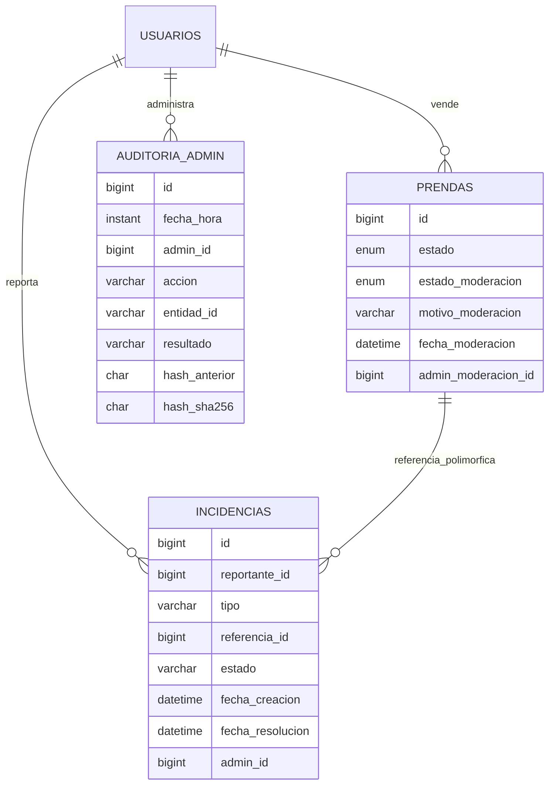

# US-14 — Descripción funcional

## 1. Objetivo y alcance

Administrar estados de cuentas, revisar contenido publicado, atender incidencias y
conservar una pista de auditoría verificable. Esta historia implementa backend Spring,
persistencia JPA/H2 y el panel Angular.

El vendedor publica libremente. Cada prenda nueva mantiene `EstadoPrenda.ACTIVA` y
nace con `EstadoModeracion.SIN_REVISAR`; el administrador revisa después. La moderación
es independiente del estado comercial. No existe cola de aprobación previa.

## 2. Modelo de datos

| Tabla / entidad | Campos y relación relevante |
|---|---|
| `usuarios` | Se amplía `estado` con `BLOQUEADO` (`VARCHAR`); valores vigentes: `ACTIVO`, `SUSPENDIDO`, `BLOQUEADO`, `ELIMINADO`. Migrador compatible con H2 y MySQL. |
| `prendas` | `estado` comercial (`ACTIVA`/`INACTIVA`) independiente de `estado_moderacion` (`SIN_REVISAR`/`APROBADA`/`DESACTIVADA`), `motivo_moderacion`, `fecha_moderacion` y `admin_moderacion_id`. Las prendas existentes quedan `APROBADA` por defecto; nulos históricos se normalizan a `APROBADA`, y los estados heredados `PENDIENTE`/`RECHAZADA` se traducen a `SIN_REVISAR`/`DESACTIVADA`. |
| `auditoria_admin` | `id`, `fecha_hora` (`Instant` truncado a microsegundos para concordar con la precisión de almacenamiento), `admin_id`, `admin_email`, `rol`, `accion`, `tipo_entidad`, `entidad_id`, `valor_anterior`, `valor_nuevo`, `motivo`, `ip_origen` (dirección remota HTTP), `resultado`, `hash_anterior`, `hash_sha256`. Índices por fecha, admin, acción y entidad. |
| `auditoria_admin_candado` | Fila única que se bloquea al serializar escrituras concurrentes de la cadena, incluso antes de la primera entrada. La última entrada también se carga con bloqueo pesimista. |
| `incidencias` | `reportante_id`, email y rol, tipo, referencia polimórfica (`referencia_tipo`/`referencia_id`/detalle), asunto, descripción, estado, respuesta, admin asignado, fecha de creación y fecha de resolución. Índices para estado, reportante, fechas y referencia. |

`RegistroAuditoria` está anotado `@Immutable`; las columnas son `updatable=false`.
`RegistroAuditoriaRepository` expone solo `save`, consultas y locks, sin borrado ni
actualización. Esto evita modificaciones accidentales a través de la aplicación, no
frente a un operador de base de datos con privilegios.

### Integridad de auditoría

Para cada fila se calcula SHA-256 de los campos, codificados en orden estable con marca
de nulo y longitud de bytes UTF-8, más el hash anterior. El primer registro usa 64 ceros
como hash génesis. El formato de longitud evita colisiones ambiguas por separadores.
Una fila de bloqueo global y el lock de la última fila serializan escritores en la misma
transacción. La verificación recorre por id y recalcula ambos eslabones.

En MySQL, un operador debe ejecutar `auditoria-inmutable-mysql.sql` después de crear la
tabla; los triggers rechazan `UPDATE` y `DELETE`. Restringir además permisos de DDL del
usuario de aplicación. **H2 no soporta estos triggers MySQL**: en H2 rige la interfaz
append-only y la comprobación de hash detecta una edición/borrado, pero no previene la
operación SQL de forma equivalente.

El hash detecta cambios no autorizados sin recalcular la cadena completa; no es una
firma digital y un administrador de BD que pueda reescribir todo el historial y los
triggers está fuera del límite de confianza de este mecanismo.

## 3. Transiciones y reglas

### Usuario

| Estado actual | Habilitar → `ACTIVO` | Suspender → `SUSPENDIDO` | Bloquear → `BLOQUEADO` |
|---|---:|---:|---:|
| `ACTIVO` | — | Sí | Sí |
| `SUSPENDIDO` | Sí | — | Sí |
| `BLOQUEADO` | Sí | Sí | — |
| `ELIMINADO` | No | No | No |

Todas requieren motivo de 10 a 500 caracteres. Se rechazan acciones sobre la cuenta
propia del administrador y sobre cualquier cuenta con rol `ADMINISTRADOR`. Los cambios
se hacen con `UsuarioRepository.findByIdForUpdate`; la auditoría de éxito participa de
la transacción. Al suspender/bloquear, la incidencia automática de apelación se crea antes
del commit en la misma transacción: si la incidencia no puede persistirse, se revierte
el cambio de estado. El evento post-commit queda únicamente para el envío asíncrono del
correo. Una cuenta no activa invalida la autenticación JWT y no accede a rutas protegidas.
El login responde `403` con un mensaje diferente para `SUSPENDIDO` y `BLOQUEADO`, e
indica que la apelación ya fue abierta y la respuesta llegará por correo.

Suspender/bloquear a un vendedor no reescribe el estado de sus prendas: se ocultan por
la condición del propietario activo.

### Moderación posterior

| Moderación actual | Aprobar | Desactivar (motivo requerido) | Restaurar |
|---|---|---|---|
| `SIN_REVISAR` | `APROBADA` | `DESACTIVADA` | — |
| `APROBADA` | Conflicto | `DESACTIVADA` | — |
| `DESACTIVADA` | `APROBADA` (acción registrada como restauración) | Conflicto | `APROBADA` |

Desactivar exige motivo de 10 a 500 caracteres, registra admin/fecha/motivo en la
prenda, escribe auditoría y publica aviso al vendedor después del commit. Editar o
cambiar estado de publicación por el vendedor se rechaza mientras la moderación sea
`DESACTIVADA`. El vendedor puede ver motivo y abrir una `APELACION_PRODUCTO`.

La prenda se ofrece a clientes solo si `EstadoPrenda.ACTIVA`, moderación distinta de
`DESACTIVADA` y vendedor `ACTIVO`. `SIN_REVISAR` es visible y comprable. El migrador
conserva la visibilidad de las prendas existentes convirtiéndolas a `APROBADA`.

Cuando un artículo deja de ser visible, se mantiene en el carrito pero se indica como
no disponible; no se permite iniciar ni confirmar un checkout nuevo con él. No se
alteran pedidos ya pagados ni se modifica el estado comercial por moderación.

### Incidencias

Tipos: `APELACION_SUSPENSION`, `APELACION_PRODUCTO`, `REPORTE_PRODUCTO`,
`SOPORTE_GENERAL`. Estados: `ABIERTA` → `EN_REVISION` → `RESUELTA` o `RECHAZADA`.
Asunto 5–200, descripción 20–4000; respuestas de admin 10–4000 caracteres.

- Al suspender/bloquear una cuenta se genera automáticamente una `APELACION_SUSPENSION`
  asociada al reportante dentro de la misma transacción del cambio de estado, evitando
  dejar una cuenta deshabilitada sin incidencia. El correo se envía en forma asíncrona
  después del commit. No se entrega un endpoint anónimo que acepte texto y correo: queda
  pendiente un desafío por email con expiración y límite de solicitudes.
- Solo el vendedor dueño de una prenda `DESACTIVADA` puede crear su apelación.
- El cliente genera `REPORTE_PRODUCTO` desde el detalle de una prenda. Un reporte en
  estado abierto/en revisión aumenta su prioridad en la cola del admin.
- Admin toma, resuelve o rechaza; la respuesta se conserva y se notifica al usuario.

## 4. API

Base local: `http://localhost:8080`; en frontend `environment.apiUrl` termina en `/api`.
Se necesita `Authorization: Bearer <JWT>` en rutas por rol. Las rutas administrativas
usan `hasRole('ADMINISTRADOR')`, y las de incidencias de usuario distinguen la sesión
cliente o vendedor.

### Administración, moderación, auditoría

| Método | Ruta | Acceso | Propósito |
|---|---|---|---|
| `GET` | `/api/admin/usuarios?pagina=0&tamano=10&rol=&estado=&texto=` | Administrador | Lista paginada y filtrada. |
| `GET` | `/api/admin/usuarios/{id}` | Administrador | Detalle de cuenta. |
| `PUT` | `/api/admin/usuarios/{id}/estado` | Administrador | Estado destino y motivo. |
| `GET` | `/api/admin/moderacion/prendas?pagina=0&tamano=10&vendedorEmail=&estadoPrenda=&estadoModeracion=&texto=` | Administrador | Cola de publicaciones; la ruta `/api/admin/moderacion` se conserva como alias. |
| `GET` | `/api/admin/moderacion/prendas/{id}` | Administrador | Detalle, fotos, composición y tallas. |
| `POST` | `/api/admin/moderacion/prendas/{id}/aprobar` | Administrador | Marca `APROBADA`. |
| `POST` | `/api/admin/moderacion/prendas/{id}/desactivar` | Administrador | `{"motivo":"..."}`; `/rechazar` es alias heredado. |
| `POST` | `/api/admin/moderacion/prendas/{id}/restaurar` | Administrador | Restaura a `APROBADA`. |
| `GET` | `/api/admin/auditoria` | Administrador | Filtra/pagina por admin, acción, entidad, rango fecha y resultado. |
| `GET` | `/api/admin/auditoria/integridad` | Administrador | Recalcula la cadena completa. |
| `GET` | `/api/admin/incidencias` | Administrador | Bandeja por estado, tipo, rol y texto. |
| `GET` | `/api/admin/incidencias/{id}` | Administrador | Detalle. |
| `POST` | `/api/admin/incidencias/{id}/tomar` | Administrador | Asigna y cambia a `EN_REVISION`. |
| `POST` | `/api/admin/incidencias/{id}/resolver` | Administrador | Resuelve con `{"respuesta":"..."}`. |
| `POST` | `/api/admin/incidencias/{id}/rechazar` | Administrador | Rechaza con `{"respuesta":"..."}`. |
| `GET` | `/api/admin/resumen` | Administrador | KPIs de usuarios, prendas e incidencias. |
| `GET/POST` | `/api/cliente/incidencias` | Cliente | Consulta propias y crea soporte/reporte. |
| `GET/POST` | `/api/vendedor/incidencias` | Vendedor | Consulta propias y crea soporte/apelación de producto. |

Las respuestas paginadas siguen `PaginaResponse`: `contenido`, `pagina`, `tamano`,
`totalElementos`, `totalPaginas`.

### Ejemplos

Suspender una cuenta:

```http
PUT /api/admin/usuarios/28/estado
Authorization: Bearer <JWT_ADMIN>
Content-Type: application/json

{"estado":"SUSPENDIDO","motivo":"Incumplimiento reiterado de las condiciones de uso."}
```

```json
{
  "id": 28,
  "nombre": "Valeria",
  "apellido": "Pérez",
  "email": "vendedor@ejemplo.com",
  "rol": "VENDEDOR",
  "estado": "SUSPENDIDO",
  "fechaRegistro": "2026-10-12T10:15:00"
}
```

Desactivar una prenda:

```http
POST /api/admin/moderacion/prendas/91/desactivar
Authorization: Bearer <JWT_ADMIN>
Content-Type: application/json

{"motivo":"La ficha no corresponde a la composición textil declarada."}
```

Reporte de cliente:

```http
POST /api/cliente/incidencias
Authorization: Bearer <JWT_CLIENTE>
Content-Type: application/json

{
  "tipo":"REPORTE_PRODUCTO",
  "asunto":"La composición no coincide",
  "descripcion":"La etiqueta del producto informa materiales distintos a los indicados en la ficha.",
  "referenciaId":91,
  "referenciaDetalle":"Buzo infantil azul"
}
```

Consulta de integridad:

```http
GET /api/admin/auditoria/integridad
Authorization: Bearer <JWT_ADMIN>
```

```json
{"totalRegistros":42,"integra":true,"primerInconsistenteId":null,"detalle":null}
```

Errores habituales: `401` sin token o token de cuenta no activa; `403` rol no permitido;
`400` validación/motivo/rango temporal inválido; `404` recurso inexistente o ajeno
cuando aplica ocultación; `409` transición ilegal o decisión duplicada. El backend
devuelve `ErrorResponse` con mensaje/código y detalles de validación según la causa.

## 5. Frontend

La ruta lazy `/admin` ya estaba integrada en `app.routes.ts` y limitada a
`ADMINISTRADOR`; sus subrutas incluyen `/admin/usuarios`, `/admin/moderacion`,
`/admin/auditoria` y `/admin/incidencias`. El panel muestra los KPI de
`/api/admin/resumen`; el detalle de cliente añade «Reportar producto»; el listado del
vendedor presenta el motivo y el enlace a una apelación precargada.

La incidencia se crea en la ruta por rol correspondiente. La UI no ofrece al cliente
el tipo de apelación de producto; el vendedor puede seleccionarlo. La página de
incidencias de usuarios autenticados no es una solución al flujo seguro de apelación
si el JWT ya se ha invalidado por suspensión/bloqueo.

## 6. Configuración y despliegue

- No se añadieron dependencias frontend ni backend.
- El esquema lo gestiona JPA/migradores existentes; validar el despliegue sobre una
  copia real antes de activar DDL automático en producción.
- Ejecutar `auditoria-inmutable-mysql.sql` como operador autorizado después de crear
  `auditoria_admin`; no conceder permisos de `DROP`/gestión de triggers al usuario de
  ejecución de la aplicación.
- El correo requiere configuración SMTP existente en `CorreoService`; los eventos de
  suspensión/bloqueo/desactivación/resolución se ejecutan tras commit. Sin configuración,
  el entorno local registra que omite el correo.
- El endpoint de auditoría usa UTC (`Instant`); las fechas de incidencias/moderación
  usan `LocalDateTime` conforme a los modelos existentes.

## 7. Limitaciones y riesgos

1. H2 no reproduce los triggers MySQL: el esquema de test protege el append-only en el
   repositorio y permite detectar alteración por hash, pero no bloquea SQL arbitrario.
2. No hay endpoint público seguro para apelación de cuenta suspendida/bloqueada. Se
   genera incidencia al suspender/bloquear; un flujo público futuro requiere token de
   un solo uso, envío verificable al email ya registrado, caducidad, rate limit y evitar
   filtración de existencia de cuentas.
3. Las metas de RNF-08/RNF-17 no se pueden afirmar como estadísticas reales con suites
   locales. Se requiere monitorización operacional y reporte periódico.
4. `ip_origen` toma `HttpServletRequest.getRemoteAddr()`, como en el login; detrás de un
   proxy inverso registra la IP que ve la aplicación, salvo que la infraestructura
   configure correctamente la resolución confiable de IP remota.
5. El hash no sustituye un anclaje externo/firma digital; administradores de BD
   privilegiados podrían reescribir tabla y cadena.
6. La UI no cancela órdenes ni pedidos pagados al desactivar un artículo, por decisión
   de negocio; solo evita nuevas compras.

## 8. Diagramas

### Secuencia: suspensión con auditoría y eventos



### Estados de usuario y moderación



### Flujo de incidencias



### ER simplificado



## 9. Matriz de trazabilidad

| Subtarea | Archivos principales | Pruebas/evidencia | RNF |
|---|---|---|---|
| Estado y administración de cuentas | `modules/auth/model/EstadoUsuario.java`, `modules/admin/controller/UsuarioAdminController.java`, `modules/admin/service/AdminUsuarioService.java`, `modules/admin/repository/UsuarioAdminRepository.java`, `frontend/src/app/features/admin/pages/usuarios-admin/`, `frontend/src/app/features/admin/services/usuarios-admin.service.ts` | `AdminUsuarioServiceTest`, `US14AdminIntegrationTest`, `usuarios-admin.spec.ts`, `usuarios-admin.service.spec.ts` | RNF-08 |
| Modelo y revisión posterior de prendas | `modules/catalogocompras/catalogo/model/EstadoModeracion.java`, `Prenda.java`, `PrendaRepository.java`, `ModeracionProductoService.java`, `ModeracionProductoAdminController.java`, `PrendaService.java`, `frontend/src/app/features/admin/pages/moderacion/`, `frontend/src/app/features/catalogoCompras/pages/productos-lista.html` | `ModeracionProductoServiceTest`, `PrendaServiceModeracionTest`, `US14AdminIntegrationTest`, `moderacion.spec.ts`, `moderacion.service.spec.ts`, `productos-lista.spec.ts` | RNF-08 |
| Auditoría inalterable | `modules/admin/model/RegistroAuditoria.java`, `RegistroAuditoriaRepository.java`, `AuditoriaService.java`, `AuditoriaAdminController.java`, `docs/us-14/auditoria-inmutable-mysql.sql`, página `auditoria/` frontend | `AuditoriaServiceTest`, `US14AdminIntegrationTest`, `auditoria.spec.ts`, `auditoria.service.spec.ts` | RNF-08 |
| Incidencias, seguimiento y reportes | `modules/admin/model/Incidencia.java`, `IncidenciaService.java`, `IncidenciaAdminController.java`, `IncidenciaUsuarioController.java`, `frontend/src/app/features/admin/pages/{incidencias-admin,mis-incidencias}/`, `vitrina/pages/detalle.ts` | `IncidenciaServiceTest`, `US14AdminIntegrationTest`, `incidencias-admin.spec.ts`, `mis-incidencias.spec.ts`, `detalle.spec.ts` | RNF-17 y RNF-08 para acciones admin |
| Dashboard y métricas | `ResumenAdminController.java`, `ResumenAdminService.java`, `ResumenAdminResponse.java`, `dashboard-admin/` y `resumen-admin.service.ts` | `dashboard-admin.spec.ts`, `resumen-admin.service.spec.ts`, suite de integración H2 | RNF-17 |
| Visibilidad de catálogo, recomendación, carrito y checkout | `PrendaRepository.java`, `CatalogoRecomendacionAdapter.java`, `CarritoService.java`, `PedidoCheckoutService.java`, `CheckoutFacade.java` | `US14AdminIntegrationTest`, suite completa backend | RNF-08 |
| Correo por eventos post-commit | `NotificacionAdministracionListener.java`, `CorreoService.java`, eventos de administración/incidencia | Suite backend completa e integración H2; el perfil test omite entrega SMTP real | RNF-17 y RNF-08 |

## 10. Inventario de archivos versionados creados o modificados durante las fases 1–5

Los archivos de las fases anteriores de US-14 no se repiten aquí como nuevos en fase 5;
la tabla registra los paths que aparecen como cambiados en el worktree de esta sesión.

| Ruta | Cambio / propósito |
|---|---|
| `README.md` | Documentación raíz, endpoints y entrada US-14. |
| `docs/us-14/README.md` | Resumen, evidencia, DoD, RNF, suposiciones e inventario documental. |
| `docs/us-14/descripcion-funcional.md` | Este documento funcional, API y trazabilidad. |
| `docs/us-14/casos-de-prueba.md` | Casos y referencias de pruebas. |
| `docs/us-14/guia-usuario-panel-administrativo.md` | Guía operativa de la interfaz. |
| `src/main/java/co/edu/uniquindio/littlestyle/modules/admin/controller/AuditoriaAdminController.java` | Filtros de auditoría delegados al servicio. |
| `src/main/java/co/edu/uniquindio/littlestyle/modules/admin/controller/ModeracionProductoAdminController.java` | Ruta canónica y operación de desactivación. |
| `src/main/java/co/edu/uniquindio/littlestyle/modules/admin/controller/IncidenciaUsuarioController.java` | API de incidencias para usuarios. |
| `src/main/java/co/edu/uniquindio/littlestyle/modules/admin/controller/ResumenAdminController.java` | Endpoint KPI. |
| `src/main/java/co/edu/uniquindio/littlestyle/modules/admin/dto/ResumenAdminResponse.java` | Incluye prendas sin revisar. |
| `src/main/java/co/edu/uniquindio/littlestyle/modules/admin/service/AdminUsuarioService.java` | Motivo obligatorio, trazabilidad de fallos y apelación atómica al suspender/bloquear. |
| `src/main/java/co/edu/uniquindio/littlestyle/modules/admin/service/AuditoriaService.java` | Hash inequívoco, timestamp con precisión de microsegundos, IP remota y consulta paginada. |
| `src/main/java/co/edu/uniquindio/littlestyle/modules/admin/service/IncidenciaService.java` | Referencias, propiedad y consulta de métricas. |
| `src/main/java/co/edu/uniquindio/littlestyle/modules/admin/service/ModeracionProductoService.java` | Datos de decisión, motivo y auditoría de intentos fallidos. |
| `src/main/java/co/edu/uniquindio/littlestyle/modules/admin/service/NotificacionAdministracionListener.java` | Envío asíncrono de correos post-commit. |
| `src/main/java/co/edu/uniquindio/littlestyle/modules/admin/service/ResumenAdminService.java` | KPI de moderación. |
| `src/main/java/co/edu/uniquindio/littlestyle/modules/catalogocompras/carrito/service/CarritoService.java` | Disponibilidad según visibilidad administrativa. |
| `src/main/java/co/edu/uniquindio/littlestyle/modules/catalogocompras/catalogo/dto/PrendaResponse.java` | Estado y metadatos de moderación visibles al vendedor. |
| `src/main/java/co/edu/uniquindio/littlestyle/modules/catalogocompras/catalogo/repository/PrendaRepository.java` | Filtros de visibilidad y prioridad de cola. |
| `src/main/java/co/edu/uniquindio/littlestyle/modules/catalogocompras/catalogo/service/PrendaService.java` | Bloqueo de edición/reactivación por vendedor. |
| `src/main/java/co/edu/uniquindio/littlestyle/modules/catalogocompras/checkout/service/PedidoCheckoutService.java` | Mensaje accionable si un producto del carrito dejó de estar disponible. |
| `src/main/java/co/edu/uniquindio/littlestyle/modules/auth/service/AuthService.java` | Mensajes de login diferenciados para cuentas suspendidas o bloqueadas. |
| `src/main/java/co/edu/uniquindio/littlestyle/modules/auth/model/EstadoUsuario.java` | Corrección de puntuación en el Javadoc del estado bloqueado. |
| `src/main/java/co/edu/uniquindio/littlestyle/modules/catalogocompras/catalogo/model/Prenda.java` | Referencias Javadoc válidas a US-14 y RNF-08. |
| `src/main/java/co/edu/uniquindio/littlestyle/modules/catalogocompras/catalogo/model/EstadoModeracion.java` | Referencias Javadoc válidas a US-14 y RNF-08. |
| `src/test/java/co/edu/uniquindio/littlestyle/modules/admin/US14AdminIntegrationTest.java` | Integración de API/visibilidad/checkout/auditoría. |
| `src/test/java/co/edu/uniquindio/littlestyle/modules/auth/AuthSecurityIntegrationTest.java` | Mensajes de login para cuenta suspendida y bloqueada. |
| `src/test/java/co/edu/uniquindio/littlestyle/modules/auth/service/AuthServiceTest.java` | Verifica el 403 con mensaje de apelación automática. |
| `src/test/java/co/edu/uniquindio/littlestyle/modules/admin/service/AdminUsuarioServiceTest.java` | Pruebas de reglas administrativas. |
| `src/test/java/co/edu/uniquindio/littlestyle/modules/admin/service/AuditoriaServiceTest.java` | Hash, colisión e integridad. |
| `src/test/java/co/edu/uniquindio/littlestyle/modules/admin/service/IncidenciaServiceTest.java` | Reporte y apelación. |
| `src/test/java/co/edu/uniquindio/littlestyle/modules/admin/service/ModeracionProductoServiceTest.java` | Decisiones, motivo y auditoría. |
| `src/test/java/co/edu/uniquindio/littlestyle/modules/catalogocompras/catalogo/service/PrendaServiceModeracionTest.java` | Rechazo de edición/reactivación. |
| `frontend/src/app/features/admin/models/admin.models.ts` | Estados/contratos de moderación, incidencia, KPI e integridad. |
| `frontend/src/app/features/admin/pages/auditoria/auditoria.html` | Resultado correcto de integridad. |
| `frontend/src/app/features/admin/pages/auditoria/auditoria.spec.ts` | Pruebas del visor e integridad. |
| `frontend/src/app/features/admin/pages/auditoria/auditoria.ts` | Imports/rutas relativos del visor. |
| `frontend/src/app/features/admin/pages/dashboard-admin/dashboard-admin.html` | KPI y orden posterior de moderación. |
| `frontend/src/app/features/admin/pages/dashboard-admin/dashboard-admin.spec.ts` | KPI de prendas sin revisar. |
| `frontend/src/app/features/admin/pages/dashboard-admin/dashboard-admin.ts` | Imports relativos corregidos. |
| `frontend/src/app/features/admin/pages/incidencias-admin/incidencias-admin.ts` | Tipo `REPORTE_PRODUCTO` y imports corregidos. |
| `frontend/src/app/features/admin/pages/mis-incidencias/mis-incidencias.html` | Referencias de reporte/apelación. |
| `frontend/src/app/features/admin/pages/mis-incidencias/mis-incidencias.spec.ts` | Validación de formulario, roles y precarga de apelación. |
| `frontend/src/app/features/admin/pages/mis-incidencias/mis-incidencias.ts` | Rutas por rol, precarga y opciones permitidas. |
| `frontend/src/app/features/admin/pages/moderacion/moderacion.html` | Estados actuales y acción desactivar/restaurar. |
| `frontend/src/app/features/admin/pages/moderacion/moderacion.spec.ts` | Casos de moderación. |
| `frontend/src/app/features/admin/pages/moderacion/moderacion.ts` | Contrato y acciones de moderación. |
| `frontend/src/app/features/admin/pages/usuarios-admin/usuarios-admin.spec.ts` | Asincronía de foco del diálogo. |
| `frontend/src/app/features/admin/pages/usuarios-admin/usuarios-admin.ts` | Imports relativos corregidos. |
| `frontend/src/app/features/admin/services/auditoria.service.spec.ts` | Contrato JSON `integra`. |
| `frontend/src/app/features/admin/services/incidencias.service.spec.ts` | Rutas por rol de incidencias. |
| `frontend/src/app/features/admin/services/incidencias.service.ts` | Rutas cliente/vendedor dinámicas por rol. |
| `frontend/src/app/features/admin/services/moderacion.service.spec.ts` | Contrato canónico y estados actuales. |
| `frontend/src/app/features/admin/services/moderacion.service.ts` | Ruta canónica y acción `desactivar`. |
| `frontend/src/app/features/catalogoCompras/models/prenda.models.ts` | Campos de moderación vendedor. |
| `frontend/src/app/features/catalogoCompras/pages/productos-lista.html` | Motivo, bloqueo vendedor y enlace para apelar. |
| `frontend/src/app/features/catalogoCompras/pages/productos-lista.spec.ts` | Cobertura de prendas desactivadas. |
| `frontend/src/app/features/catalogoCompras/pages/checkout.spec.ts` | Comprueba que checkout muestre el mensaje accionable de disponibilidad. |
| `frontend/src/app/features/vitrina/pages/detalle.html` | Diálogo accesible para reportar producto. |
| `frontend/src/app/features/vitrina/pages/detalle.spec.ts` | Validación y creación de reporte. |
| `frontend/src/app/features/vitrina/pages/detalle.ts` | Envío de `REPORTE_PRODUCTO`. |
| `frontend/src/app/shared/components/navbar/navbar.spec.ts` | Aislamiento de módulos de test del navbar. |
| `frontend/src/app/app.routes.ts` | Integra las rutas lazy del panel administrativo. |
| `frontend/src/app/core/guards/role.guard.spec.ts` | Prueba el guard de acceso de administrador. |
| `frontend/src/app/features/home/pages/admin-panel/admin-panel.ts` | Sustituido por las páginas y rutas del nuevo panel. |
| `frontend/src/app/shared/components/navbar/navbar.ts` | Enlace de navegación del panel administrativo. |
| `docs/us-14/auditoria-inmutable-mysql.sql` | Triggers MySQL que bloquean UPDATE/DELETE de auditoría. |
| `frontend/src/app/features/admin/admin.routes.ts` | Rutas lazy protegidas por rol. |
| `frontend/src/app/features/admin/pages/incidencias-admin/incidencias-admin.html` | Bandeja y detalle de incidencias administrativas. |
| `frontend/src/app/features/admin/pages/incidencias-admin/incidencias-admin.spec.ts` | Pruebas de bandeja y resolución. |
| `frontend/src/app/features/admin/pages/usuarios-admin/usuarios-admin.html` | Tabla y controles de administración de cuentas. |
| `frontend/src/app/features/admin/services/auditoria.service.ts` | Consulta y verificación de integridad. |
| `frontend/src/app/features/admin/services/resumen-admin.service.ts` | Consulta del dashboard KPI. |
| `frontend/src/app/features/admin/services/resumen-admin.service.spec.ts` | Pruebas HTTP del servicio de resumen. |
| `frontend/src/app/features/admin/services/usuarios-admin.service.ts` | Operaciones de búsqueda/cambio de estado de cuenta. |
| `frontend/src/app/features/admin/services/usuarios-admin.service.spec.ts` | Pruebas HTTP de administración de cuentas. |
| `src/main/java/co/edu/uniquindio/littlestyle/modules/admin/dto/CambioEstadoCuentaRequest.java` | DTO para estado destino y motivo. |
| `src/main/java/co/edu/uniquindio/littlestyle/modules/admin/dto/PrendaAdminDetalleResponse.java` | DTO de detalle para la cola de moderación. |
| `src/main/java/co/edu/uniquindio/littlestyle/modules/admin/dto/PrendaAdminResponse.java` | DTO resumido de moderación. |
| `src/main/java/co/edu/uniquindio/littlestyle/modules/admin/dto/RechazoPrendaRequest.java` | DTO de motivo para desactivar una prenda. |
| `src/main/java/co/edu/uniquindio/littlestyle/modules/admin/dto/UsuarioAdminResponse.java` | DTO de la bandeja administrativa de usuarios. |
| `src/main/java/co/edu/uniquindio/littlestyle/modules/admin/model/AccionAuditoria.java` | Catálogo de acciones auditables. |
| `src/main/java/co/edu/uniquindio/littlestyle/modules/admin/model/EstadoIncidencia.java` | Estados del ciclo de vida de incidencia. |
| `src/main/java/co/edu/uniquindio/littlestyle/modules/admin/model/Incidencia.java` | Entidad de soporte, apelación y reporte. |
| `src/main/java/co/edu/uniquindio/littlestyle/modules/admin/model/RegistroAuditoria.java` | Entidad inmutable de la cadena de auditoría. |
| `src/main/java/co/edu/uniquindio/littlestyle/modules/admin/model/ResultadoAuditoria.java` | Resultado de la acción auditada. |
| `src/main/java/co/edu/uniquindio/littlestyle/modules/admin/model/TipoEntidad.java` | Tipo de entidad referenciada por auditoría. |
| `src/main/java/co/edu/uniquindio/littlestyle/modules/admin/model/TipoIncidencia.java` | Tipos de incidencia disponibles. |
| `src/main/java/co/edu/uniquindio/littlestyle/modules/admin/repository/IncidenciaRepository.java` | Persistencia y filtros de incidencias. |
| `src/main/java/co/edu/uniquindio/littlestyle/modules/admin/repository/RegistroAuditoriaRepository.java` | Lecturas append-only y locks de cadena. |
| `src/main/java/co/edu/uniquindio/littlestyle/modules/auth/repository/UsuarioRepository.java` | Bloqueo pesimista y consultas administrativas. |
| `src/main/java/co/edu/uniquindio/littlestyle/modules/catalogocompras/catalogo/service/EstadoModeracionSchemaMigrator.java` | Migración segura de columnas de moderación. |
| `src/main/java/co/edu/uniquindio/littlestyle/shared/correo/CorreoService.java` | Plantillas y envíos de notificación de US-14. |
| `src/main/java/co/edu/uniquindio/littlestyle/shared/event/CuentaEstadoCambiadaEvent.java` | Evento para notificar cambio de estado post-commit. |
| `src/main/java/co/edu/uniquindio/littlestyle/shared/event/PrendaModeradaEvent.java` | Evento para notificar resultado de moderación. |
| `src/main/java/co/edu/uniquindio/littlestyle/modules/admin/controller/IncidenciaAdminController.java` | API administrativa de incidencias. |
| `src/main/java/co/edu/uniquindio/littlestyle/modules/admin/controller/UsuarioAdminController.java` | API administrativa de cuentas. |
| `src/main/java/co/edu/uniquindio/littlestyle/modules/admin/dto/CrearIncidenciaRequest.java` | Validación de solicitudes de incidencia. |
| `src/main/java/co/edu/uniquindio/littlestyle/modules/admin/dto/IncidenciaResponse.java` | Respuesta de consulta de incidencia. |
| `src/main/java/co/edu/uniquindio/littlestyle/modules/admin/dto/ResolucionIncidenciaRequest.java` | Validación de respuesta de resolución. |
| `src/main/java/co/edu/uniquindio/littlestyle/modules/admin/model/TipoReferenciaIncidencia.java` | Tipos de referencias asociadas a incidencias. |
| `src/main/java/co/edu/uniquindio/littlestyle/modules/admin/service/AuditoriaSchemaMigrator.java` | Inicializa estructura de candado para la cadena. |
| `src/main/java/co/edu/uniquindio/littlestyle/shared/event/IncidenciaCerradaEvent.java` | Evento de notificación de cierre de incidencia. |
| `src/main/resources/correo/cuenta-estado.html` | Plantilla de estado de cuenta. |
| `src/main/resources/correo/respuesta-incidencia.html` | Plantilla de respuesta de incidencia. |
| `src/main/resources/correo/resultado-moderacion.html` | Plantilla de resultado de moderación. |
| `src/test/java/co/edu/uniquindio/littlestyle/modules/catalogocompras/catalogo/model/PrendaModeracionTest.java` | Persistencia y metadatos de moderación de prenda. |
